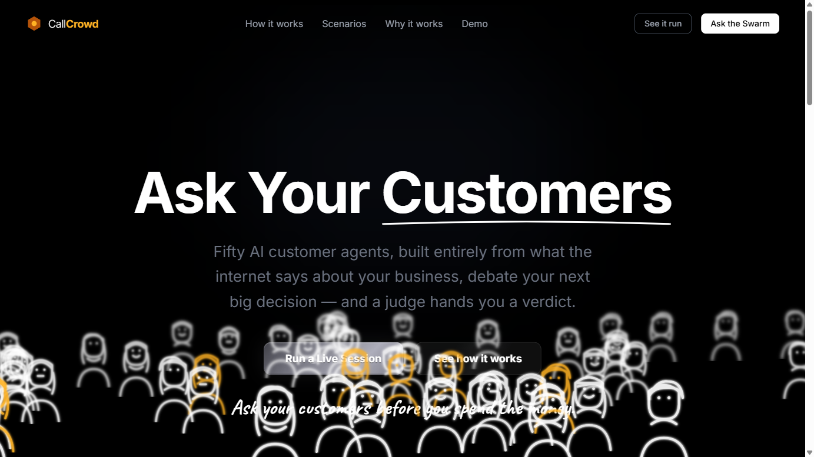
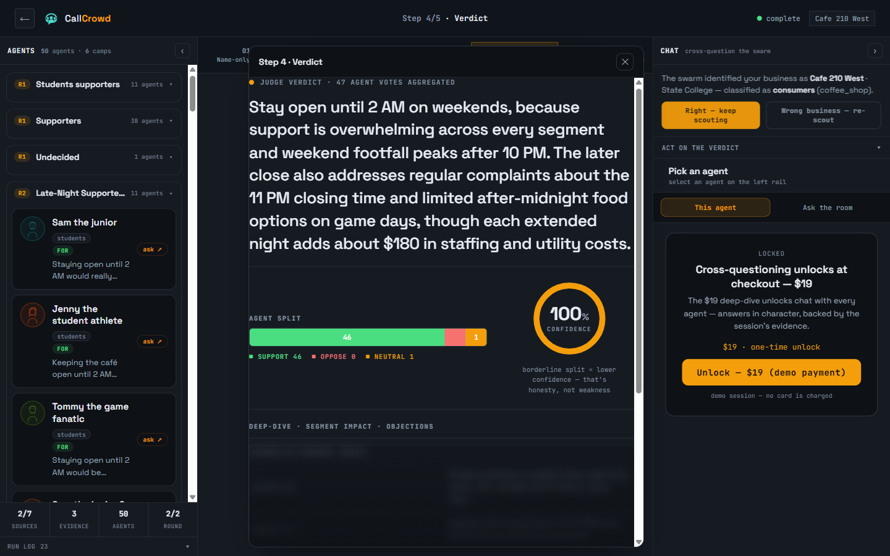
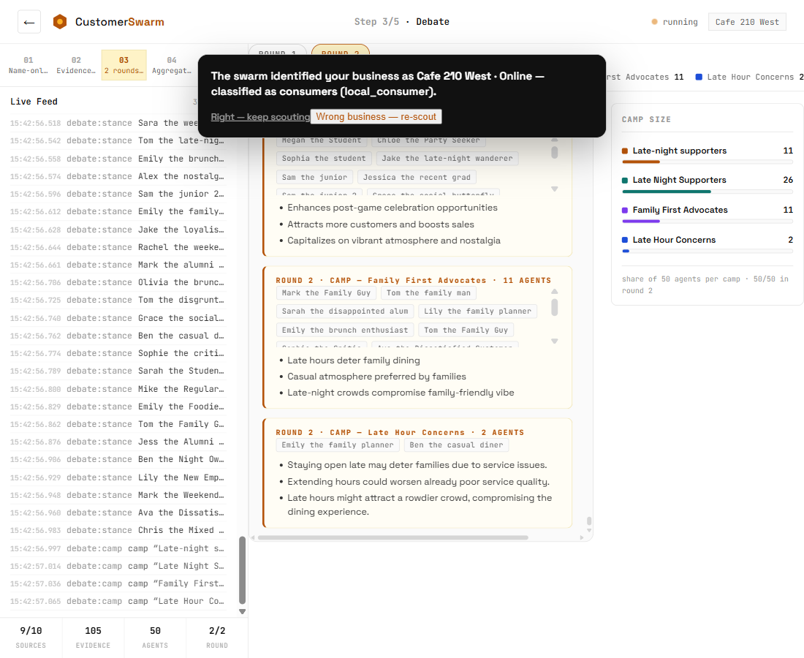
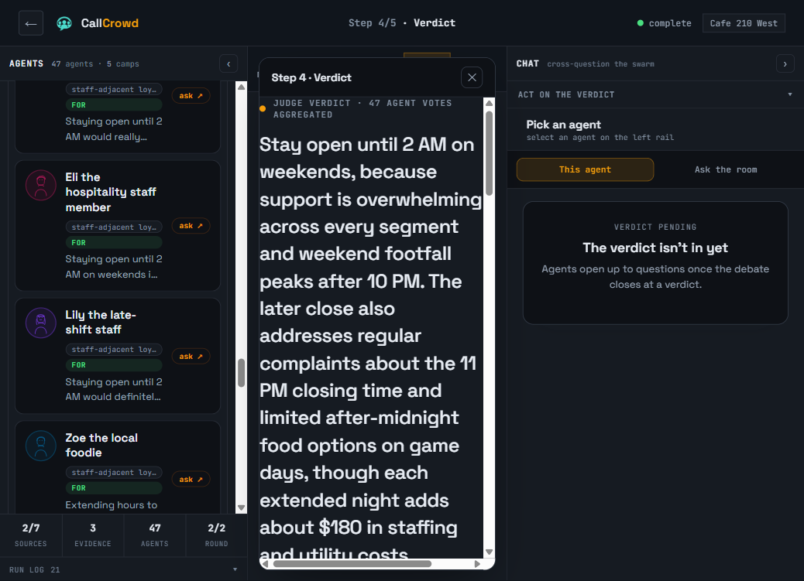
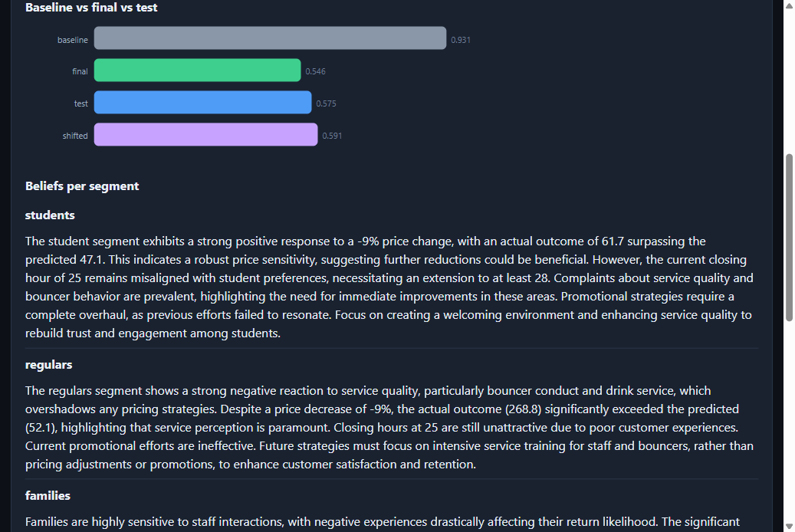
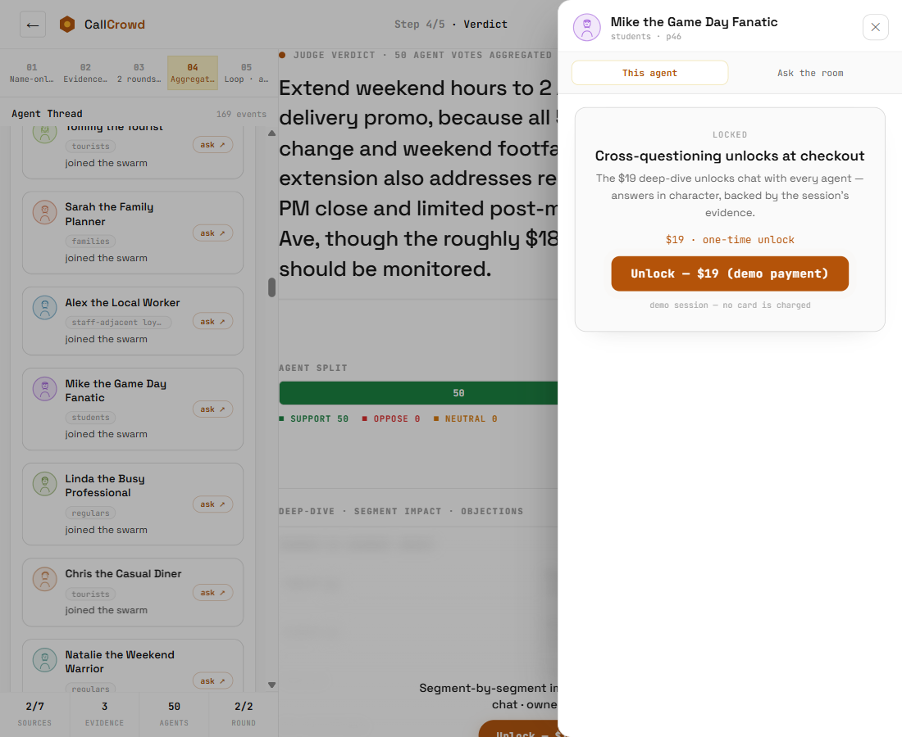
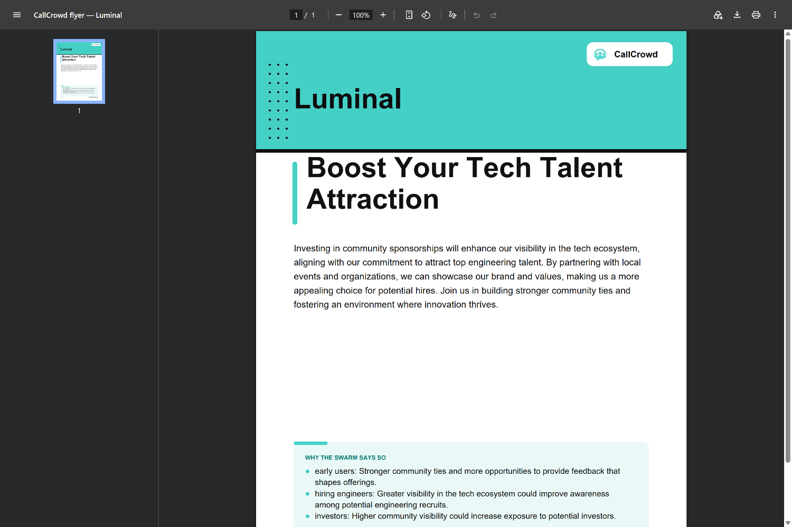
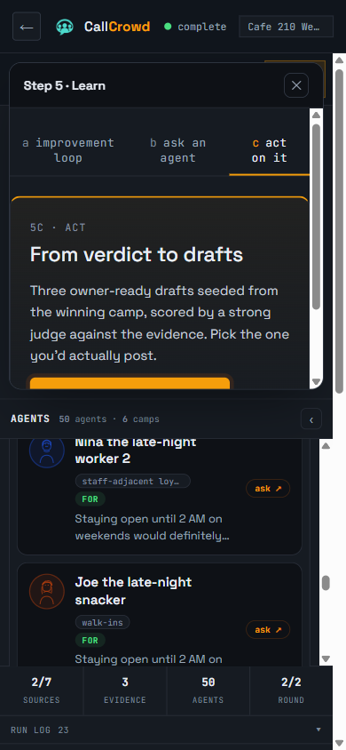

# CallCrowd — Ask your customers before you spend the money

**50 AI customer agents, built entirely from what the internet says about your business, debate your next big decision with citations — and a judge hands you a verdict. What your customers say when you're not listening, for $19 instead of a $500–2,000 market-research report.**

A business owner types **only the name of their business**. Scout adapters hit every public source they can reach, 50 customer agents built from that real record debate the owner's actual decision in two cited rounds, and an aggregation-first judge returns a verdict with a confidence the owners can audit. On top of the pipeline sits a self-improving loop trained against a seeded market calibrated from the same real reviews.



*Team of 2 · Penn State Hackathon · Oct 11, 2026 · standing demo business: Cafe 210 West, State College (150 real Google reviews scraped live that day). Early build screenshots show the pre-rename "CustomerSwarm" light theme; the shipped product is the CallCrowd dark console.*

---

## 2-minute judge demo

### Setup (one-time, any machine)

```bash
# 1) Python 3.10+ required. Then, from the repo root:
python -m venv venv
venv\Scripts\python -m pip install -r requirements.txt     # Windows
# (Linux/mac: python3 -m venv venv && venv/bin/python -m pip install -r requirements.txt)

# 2) Keys: copy .env.example -> .env and fill
#    (OPENAI_API_KEY / GROQ_API_KEY / TAVILY_API_KEY required for live runs;
#     MONGO_URI optional — Atlas semantic corpus; AWS_* optional — DynamoDB + billing)

# 3) (optional, live Google reviews) set up the scraper sidecar:
git clone https://github.com/georgekhananaev/google-reviews-scraper-pro.git \
    services/google-reviews-scraper-pro
#    then: create its venv + `pip install -r requirements.txt`, copy config.sample.yaml to
#    config.yaml, set headless:false, and point MongoDB off (backend reads SQLite/API).
#    Without it the backend degrades gracefully: pasted/manual reviews still work.
```

### Run

```cmd
scripts\start-all.cmd
```

Portable — resolves python from the repo `venv` (or PATH), no hardcoded paths; spawns three windows — idempotent, safe to re-run:

| Port | Service | What it is |
|---|---|---|
| `8300` | Google-reviews scraper sidecar | headed Chrome (SeleniumBase UC), REST trigger (`services/google-reviews-scraper-pro`) |
| `8000` | FastAPI backend | the product API + `/api/sessions/{id}/stream` SSE channel |
| `9000` | static frontend | `http://127.0.0.1:9000/console.html` — open this |

Then, in the console:

1. **Type only a business name.** No sign-up, no pasting. `Cafe 210 West` is the standing demo.
2. Watch the swarm identify the business (wrong match? one click → **re-scout**), stream evidence cards, build 50 personas, debate in 2 rounds, land a verdict — end to end in about a minute.
3. No keys, no network? Every page also replays a **recorded session**: `console.html?mock=1` (and the console falls back to the recording automatically if the API is down).
4. **$19 unlock, zero card risk:** the demo runs the sandbox checkout story — a session is paid either by the real AWS-Monetization/Stripe handoff or the explicit demo path `POST /api/sessions/{id}/pay/mark-paid`. For a friction-free judge pass set `UNLOCK_FREE=1` on the backend; the gate opens and the page says no card was charged. `MONETIZATION_STAGE` (default: derived from the app id's `/sandbox` ARN suffix) keeps every real checkout in sandbox unless someone deliberately flips it to live.

Full API surface is pinned in [`docs/api-contract.md`](docs/api-contract.md) — snapshots, one SSE channel, question, chat, pay, run-loop, reroll, act, flyer.pdf.

---

## How it works

```
 owner types: "Cafe 210 West"                (name-only intake)
        │
        ▼
 [1] ENTITY RESOLVE ── app/entity.py
     Google/Tavily identity+address anchor; ambiguous matches get a confirm card at the launcher (intake), never mid-run
        │
        ▼
 [2] SCOUT ADAPTERS (7, parallel) ── app/adapters.py · app/adapters_ext.py
     google_reviews → scraper sidecar (:8300, headed Chrome, SQLite cache, 150-review cap;
                    CAPTCHA → the human solves it → cached forever after)
     tavily_web (news/competitors) · company_context (web/menu) · weather · calendar · events · manual_paste
     → evidence cards {claim, source_url, type} → Mongo Atlas + DynamoDB (dual-write) + file floor
        │
        ▼
 [3] 50 EMERGENT PERSONAS ── app/llm/personas.py
     3–7 segments invented from the business's own reviews, ~5 batched LLM calls,
     every agent cites the review ids it was built from
        │
        ▼
 [4] CAMP-DIGEST DEBATE ── app/llm/debate.py  (2 rounds, SSE)
     camps auto-cluster per round; round-2 agents read the OPPOSING camp's 2–3 strongest args;
     fabricated evidence demoted to neutral
        │
        ▼
 [5] AGGREGATION-FIRST JUDGE ── app/llm/judge.py  (gpt-5.6-sol, temp 0)
     the tally/camps/segment split is COMPUTED, not hallucinated; confidence = normalized
     tally skew; one LLM call writes the recommendation; cached by (business, question)
        │
        ├─▶ [5b] ACT DRAFTS ── app/llm/act.py: winning camp seeds 3 drafts, judge scores vs evidence
        │        └─▶ FLYER PDF ── app/flyer.py (reportlab) → /api/sessions/{id}/flyer.pdf
        │
        ▼
 [6] SELF-IMPROVING LOOP (sandboxed) ── app/sim/*
     market calibrated from the real reviews → hidden seeded truth → agents learn from
     outcomes only → keep-only-improving gate → regret charts + per-segment beliefs
```

**[1] Resolve.** The swarm anchors on a verified entity before spending a single scout call.



**[2] Evidence.** Live cards stream over SSE — every claim carries its source, and the console shows the full run log (sessions stat below: 2–7 sources, 3–105 evidence cards).

**[3] Personas.** "Sam the junior," "Jenny the student athlete," "Tom the disgruntled regular" — segments the data invented, not a template.

**[4] Debate.** Camps form and reform across rounds; round 2 argues against the other camp's best material.



**[5] Verdict.** The tally is math, the prose is one pinned-model call. "Borderline split = lower confidence — that's honesty, not weakness."



**[5b] Act.** Verdict → executable artifact ("Ask your customers, *then let them draft it*"), with the flyer PDF one click away (see [Act + flyer PDF](#track-2--build--sell)).

---

## Track coverage and proof

### Track 1A — Self-Improving Agent Team

Seeded-market loop: **calibrate → hide truth → learn from outcomes → keep only improvements.**

- **Calibrated bounds, anti-circularity** (`app/sim/truth.py`): one cheap LLM call proposes parameter **ranges** from the real reviews; a truth is sampled inside the ranges with a pinned seed and **hidden from the agents** — they only ever see outcome feedback after proposing a policy. A reroll button (`POST .../loop/reroll`) resamples the truth with a new seed to show the loop works across market draws.
- **Deterministic market** (`app/sim/market.py`): plain Python, no LLM; training on train contexts, evaluation on **test/shifted contexts the loop never saw** (`app/sim/contexts.py`).
- **Keep-only-improving gate** (`app/sim/loop.py`, `_keep_gate`): worse rounds cannot rewrite beliefs — memory only moves toward lower regret.
- **Measured result — held-out regret 0.707 → 0.294 (−58%)** on unseen scenarios, one full run ≈ 54 s (`docs/sales-pitch.md` §5, `docs/video-script.md` beat 8; earlier instrumented run: 0.895 → 0.743 with held-out 0.792). Endpoints: `run-loop`, `loop-chart`, `reroll` (`app/loop_api.py`).



*One real run: baseline 0.931 → final 0.546, test 0.575, shifted-context 0.591 — plus the per-segment beliefs the loop wrote (students: "pricing cuts work; extended hours misaligned; promos need a rebuild").*

### Track 2 — Build & Sell

- **Product is a purchase flow, not a slide.** Free tier = verdict + confidence; $19 one-time deep dive = segment-by-segment impact + top objections + per-agent chat + Act drafts. The gate is enforced server-side (`app/main.py` `_unlocked`, teaser-only snapshot payload) — not a CSS trick.
- **Teaser-gate UX captured mid-purchase:** the $19 unlock card sits next to a locked verdict section.



- **Live on-site selling plan** — a full walk-up script for local business owners, with demo choreography, 5 predictable objections with answers, proof points, and follow-up capture: [`docs/sales-pitch.md`](docs/sales-pitch.md). Designed so the *owner* types the two inputs while the agent browses visibly.
- **Mobile is the selling form factor** — the whole verdict/gate/chat flow is phone-usable (screenshot in the sales section below).

### AWS (three surfaces)

| Surface | What we did | Proof |
|---|---|---|
| **DynamoDB session state** | `app/storage.py` dual-writes every session mutation to table **`callcrowd_sessions`** (PAY_PER_REQUEST, created if missing), under Mongo-primary / DDB-mirror / **`data/sessions.json` file floor**, with per-mutation failure logging that never 500s the API | end-to-end dual-write verified during the build by DDB item-count check (build session log); storage has its own test file |
| **AWS App Monetization (private beta)** | `app/billing.py`: botocore **SigV4**-signed HTTP-direct client to `appmonetization` on `us-west-2.alpha.monetization.aws.dev` — usage metering (`PutEvent`), entitlement gating (`GetEntitlementDecision`, **fail-closed DENY** on outage so paid features never leak), hosted checkout (`CreateSubscriptionCheckoutSession`); `/pay` is AWS-first with Stripe/demo fallback; emails→sha1 uids (service userId charset); WAF-rejected `localhost` return URLs patched | live app id `01a12d25f9…6034`, 2 metrics (`unlock_deep_dive`, `run_decision`) + 2 plans (Walkthrough $0 / **Deep Dive $19**) created → `.monetize/spec.json`; **sandbox checkout URL minted** in a live end-to-end pay test; 20 billing tests in `tests/test_billing.py` |
| **Monetize-skill run record** | full pricing configure run (analysis → plans → wire-up) logged under `.monetize/`, with `.env.monetization` carrying the connection | `.monetize/spec.json`, `.env.monetization` |

### MongoDB Atlas

- Database **`customer_swarm`** with the six PRD-named collections — **businesses · evidence · personas · debates · beliefs · round_scores** — projected from each session doc by a **fire-and-forget mirror** (`app/mongo_mirror.py`): every call catches everything, the product never blocks or slows on the mirror, and it engages only when `MONGO_URI` is set and pings.
- Verified **live** during the build (ping + write check, mirror wired into `app/main.py` and `app/loop_api.py` for `beliefs`/`round_scores`).

### Real-data ingest

- **150 live Google reviews** scraped for Cafe 210 West (97 with text), ~65 s/scrape, **no CAPTCHA on the standing demo** — via the SeleniumBase-UC sidecar in `services/google-reviews-scraper-pro` (git-ignored vendor + our HTTP bridge `app/scrape/bridge.py`, SQLite cache, 150-review cap). When Google does block, the headed window pops and **a human solves the CAPTCHA** — by design that's the operating story, and everything caches after it.
- **Tavily scout** (news/competitors, cards with sources) plus **weather / calendar / events / company-web** context adapters over Open-Meteo, date.nager.at, and the entity's own web presence (`app/adapters_ext.py`).
- Real ingest artifacts live in `data/REAL-reviews-cafe210-west.txt`; the mock-coverage layer (`/api/mock-session/{id}`, `app/mock_debate.py`) replays a recorded session offline.

### Entrepreneurship & Bloomerang/nonprofit track — what honestly exists

- The **business-class router** (`app/business_class.py`) genuinely classifies into `local_consumer / startup / b2b_service / regulated`, and `regulated` keys on `nonprofit` (plus clinic, law, medical), selecting **persona-family prompts** — e.g. startup → *early users, skeptical devs, investors, hiring engineers, churned users*; b2b → *procurement, finance sign-off, IT/security reviewers* — instead of a one-cafe template (`app/models.py` `PERSONA_FAMILY_HINTS`).
- What we did **not** do: run a real nonprofit customer or Bloomerang-specific workflow. No screenshots, numbers, or quotes exist for that; the product's *generality mechanism* exists and is tested — a named nonprofit deployment does not, and we'd rather say so.

### Act drafts + flyer PDF (the "then let them draft it" step)

The same winning-camp arguments seed 3 drafts, the strong judge scores them against the session's evidence (`app/llm/act.py`), and the flyer variant renders to a **reportlab PDF** served from `GET /api/sessions/{id}/flyer.pdf` (`app/flyer.py`, 8 tests) with a "why the swarm says so" evidence panel baked into the document.



### On-site selling form factor



---

## Tech stack

| Layer | Choice | Why / where |
|---|---|---|
| Backend | **FastAPI + Pydantic**, one SSE channel per session | `app/main.py`, `app/loop_api.py`; single pinned contract `docs/api-contract.md` |
| Billing client | **botocore SigV4Auth + httpx** (no hand-rolled signing), fail-closed entitlement, 60 s TTL cache | `app/billing.py` |
| Storage | **MongoDB Atlas** (semantic corpus, 6 collections) + **DynamoDB `callcrowd_sessions`** (session state, dual-write) + **JSON file floor** (always written) | `app/mongo_mirror.py`, `app/storage.py` |
| LLM lanes | crowd: **gpt-4o-mini** primary → Groq `gpt-oss-120b` fallback (8k-TPM free tier too slow for full runs) → Luminal parked pending base URL; judge: **gpt-5.6-sol** pinned "strong", never falls through to the crowd lane | `app/config.py` `crowd_lanes()` / `strong_lane()`, `app/llm/client.py` (round-robin + cooldown, concurrency knob, Groq json-mode guard) |
| Scraping | **SeleniumBase UC** headed-Chrome sidecar (own API on :8300, SQLite cache, human-in-the-loop CAPTCHA) | `services/google-reviews-scraper-pro`, bridge `app/scrape/bridge.py` |
| Contexts | Tavily search + Open-Meteo + date.nager.at + entity web fetch | `app/entity.py`, `app/adapters_ext.py` |
| Frontend | **Vanilla JS + SSE + inline-SVG charts** (no framework, no build step), full offline mock replay | `static/console.html`, `static/index.html` |
| Documents | **reportlab** flyer PDF | `app/flyer.py` |
| Tests | **pytest — 106 tests passing** in one clean run (~50 s) | `tests/` |

## Engineering notes

**Determinism.** The judge refuses to freehand numbers: tallies, camps, and segment splits are computed from structured Pydantic stance votes; confidence *is* the normalized tally skew, so a near-even split yields a low-confidence verdict by construction ("that's honesty, not weakness"). One temp-0 pinned-model call writes only the prose. Verdicts are cached by `(business, question)` — re-asking is free and identical. The crowd model is fixed per product for reproducibility.

**Generality.** Nothing in the pipeline hardcodes a domain: segments and personas *emerge from the business's own evidence* ("the swarm identified your business…" banner with a wrong-business → re-scout escape hatch), and the business-class router swaps persona families for startups, B2B, and regulated/nonprofit classes.

**Model-routing philosophy.** Cheap tier-1 crowd work, one pinned strong lane for the verdict — the judge is 1–2 calls a run and never rides the round-robin. Every lane is one line of env; Luminal slots in as a crowd lane the moment a base URL exists.

**Honest framing (we demo it this way too).** The Track 1A market is *simulated but calibrated from real reviews* — ranges come from the business's actual reviews, truth is sampled inside them and hidden, and the loop discovers it through outcomes like a real market. In production owners would log real outcomes and the swarm learns from those. When Google blocks the agent, a human solves the gate and everything caches. We tell judges this out loud rather than blur it.

**Token cost per run.** A full debate is ~110 crowd calls and ~110–125K tokens (PRD §4); on gpt-4o-mini that is roughly **two cents per verdict**, judge included. The loop adds ~69 calls; run-loop completes in ~54 s.

## Tests

**100 tests collected** (`venv/Scripts/python.exe -m pytest tests -q`).

| File | Covers |
|---|---|
| `test_billing.py` (20) | SigV4 client config parse, entitlement allow/deny + cache, checkout, server-side gates (`/pay`, chat, act, snapshot teaser) |
| `test_entity.py` (16) | entity resolution, address anchoring, wrong-business rescout |
| `test_act.py` (14) | draft seeding, judge scoring, unpaid 402, payload persistence |
| `test_chat.py` (10) | in-character replies with evidence ids, 402/404 paths |
| `test_sim.py` (11) | range calibration, sampled truth, keep-gate, regret eval |
| `test_llm_core.py`, `test_loop_api.py`, `test_sim_contexts.py`, `test_storage_persist.py`, `test_flyer.py` | lane failover, loop endpoints, shifted contexts, storage dual-write + file floor, PDF render |

**Status: 106/106 green.** The six `test_billing.py` reds in the draft were test-env isolation (the live demo flag `UNLOCK_FREE=1` leaked into pay-gate tests); the suite now pins `UNLOCK_FREE=0` in its `_env` fixture and passes clean in one run.